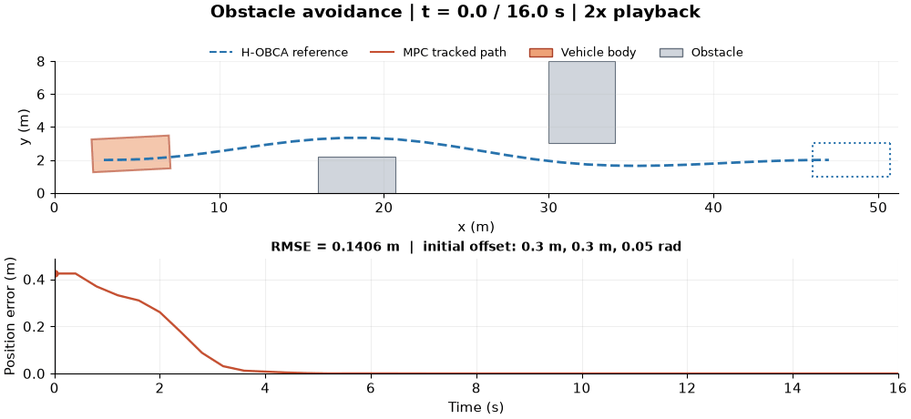
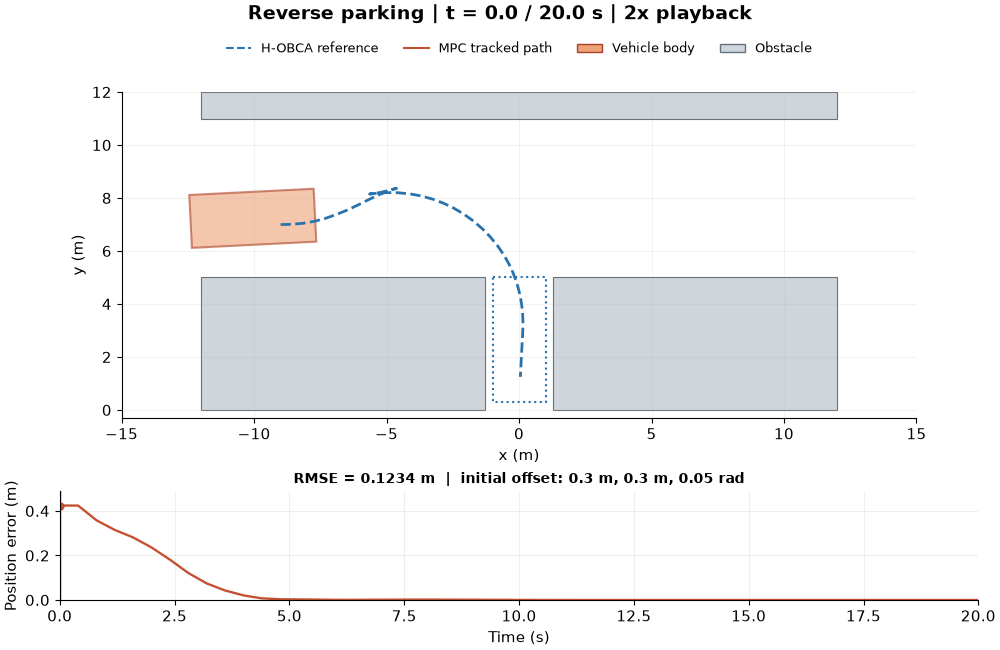

# Vehicle Trajectory Planning and Tracking Control in MATLAB

**Yuwen Wang**  
MSc student in Mechanical Engineering, The University of Hong Kong

This project connects geometric path search, constrained trajectory optimization and feedback tracking for a car-like vehicle. Two MATLAB simulations cover obstacle avoidance in a narrow road corridor and reverse parking in a 2.6 m-wide bay. Hybrid A\* provides a geometric warm start, an H-OBCA-style nonlinear program refines the trajectory, and a linear time-varying model predictive controller tracks it with an initial pose offset.

The repository contains the MATLAB source, saved reference and tracked trajectories, numerical results and animations. The work demonstrates integration and analysis of established planning and control methods; it does not introduce a new Hybrid A\*, OBCA or MPC algorithm.

[HTML preview](README.html) · [Numerical results](docs/RESULTS.csv) · [Method and implementation notes](docs/METHOD_NOTES.md)

## Simulation demonstrations

### Obstacle avoidance



A 4.7 m × 2.0 m vehicle follows an S-shaped reference around two static rectangular obstacles in a 50 m × 8 m corridor. The animation replays the saved perturbed-start tracking result used in the table below.

### Reverse parking



The vehicle maneuvers from the access aisle into a 2.6 m-wide perpendicular bay between two obstacles. Signed velocity allows forward and reverse motion. Both animations show stored MATLAB states at their 0.4 s sample times, at 2× playback speed with pauses at the endpoints. They do not run a planner when opened.

## Recorded results

Both saved tracking runs start with the same offset from the reference: **Δx = 0.3 m, Δy = 0.3 m, Δheading = 0.05 rad, Δspeed = 0**.

| Saved MATLAB simulation | Planning intervals | Physical horizon | Position RMSE | Maximum position error | Heading RMSE |
|---|---:|---:|---:|---:|---:|
| Obstacle avoidance | 40 | 16.0 s | 0.1406 m | 0.4243 m | 0.0333 rad |
| Reverse parking | 50 | 20.0 s | 0.1234 m | 0.4243 m | 0.0372 rad |

Position error is the Euclidean distance between the tracked and reference rear-axle positions at matching time indices. RMSE includes the initial state and all subsequent samples; the maximum in both runs is the initial position offset. These are two nominal-model, closed-loop simulations with a prescribed initial deviation, not a disturbance sweep or a real-vehicle validation. The values are recomputed from the bundled MAT files; no Python-port results are used. Full-precision values and their definitions are in [RESULTS.json](docs/RESULTS.json) and [Method notes](docs/METHOD_NOTES.md).

## Technical approach

1. **Scene representation.** Obstacles are stored as polygon vertices, half-space inequalities and a binary occupancy map. The rear axle is the vehicle reference point.
2. **Hybrid A\* search.** MATLAB's `plannerHybridAStar` finds a bounded-curvature path on an inflated occupancy map. The geometric seed is resampled to a fixed number of control intervals.
3. **Trajectory optimization.** CasADi and IPOPT solve a nonlinear program over position, heading, speed, steering and acceleration. A forward-Euler bicycle model links the states. OBCA dual separation constraints impose a 5 cm vehicle-body margin at the discrete trajectory nodes.
4. **LTV-MPC tracking.** The discrete nonlinear model is linearized along the reference. A shrinking-at-the-end, receding horizon problem computes control corrections; only the first correction is applied. The simulated vehicle is advanced with the nonlinear discrete model.
5. **Analysis.** Scripts compare sampled path curvature, approximate node clearances, planning-control limits and tracking errors.

Collision avoidance belongs to the reference planner. The tracking controller has steering and acceleration bounds but no obstacle constraints. Node constraints and the supplied clearance plots do not certify collision-free motion between samples or under tracking deviations.

## Parameters

| Shared model setting | Value |
|---|---|
| Body length × width | 4.7 m × 2.0 m |
| Wheelbase | 2.7 m |
| Body offsets from rear axle | 3.7 m forward; 1.0 m rearward; 1.0 m to each side |
| Minimum turning radius | 5.0 m |
| Maximum steering magnitude | `atan(2.7 / 5.0)` ≈ 0.4951 rad (28.37°) |
| Discretization | Forward Euler; 0.4 s per interval |
| Optimization node-clearance margin | 0.05 m |
| Planning steering-increment limit | 0.6 × 0.4 = 0.24 rad between consecutive controls |
| MPC prediction horizon | Up to 10 steps (4.0 s) |

| Scenario-specific setting | Obstacle avoidance | Reverse parking |
|---|---|---|
| Start pose `[x, y, heading]` | `[3, 2, 0]` | `[-9, 7, π]` |
| Goal pose `[x, y, heading]` | `[47, 2, 0]` | `[0, 1.3, π/2]` |
| Planning speed bound | ±6.0 m/s | ±3.0 m/s |
| Acceleration bound | ±1.5 m/s² | ±1.0 m/s² |
| Hybrid A\* map inflation | 1.0 m | 0.2 m |
| Motion primitive / interpolation length | 2.0 m / 0.5 m | 1.0 m / 0.3 m |
| Number of motion primitives | 5 | 5 |
| Forward / reverse search costs | 1.0 / 3.0 | 1.0 / 1.5 |
| Search validation distance | 0.10 m | 0.05 m |
| Optimization terminal conditions | Exact pose; zero speed | ±0.05 m per position axis, ±0.05 rad heading; speed within ±0.1 m/s |
| MPC state weights `[x, y, heading, speed]` | `[10, 10, 5, 1]` | `[15, 15, 8, 1]` |
| MPC control weights `[steering, acceleration]` | `[1, 1]` | `[1, 1]` |

The parking search uses only a small occupancy-map inflation, so its seed is not a rectangular full-body safety certificate. The saved parking reference ends at approximately −0.1000 m/s, consistent with its terminal-speed band; it should not be described as a strict standstill trajectory.

## View without MATLAB

Open **README.html** in a browser, or view this README on GitHub. Keep the `docs/media/` folder beside the documentation so the two GIFs remain available. Viewing the documentation does not execute MATLAB or modify the saved data.

## Run in MATLAB

The previously verified environment was **MATLAB R2025b on Windows**, with Navigation Toolbox and the CasADi MATLAB interface with IPOPT. MATLAB and these dependencies are not bundled. Use [MathWorks' planner documentation](https://www.mathworks.com/help/nav/ref/plannerhybridastar.html) and the [CasADi installation guide](https://web.casadi.org/docs/#obtaining-and-installing) for the required tools. The optimization code uses CasADi/IPOPT rather than `quadprog` or the Model Predictive Control Toolbox.

Extract a working copy and make its root MATLAB's **Current Folder**. The scripts use relative filenames and overwrite their scenario MAT file as each stage completes. Keep the downloaded ZIP as the saved-result reference.

Scripts importing CasADi contain `addpath('D:\casadi')`. If your installation differs, change that line in the scripts you intend to run to the directory containing `+casadi`. A Python-only CasADi installation does not provide the MATLAB interface. Check MATLAB's resolution of the dependencies:

```matlab
which plannerHybridAStar
which binaryOccupancyMap
which casadi.Opti
```

### Obstacle-avoidance pipeline

```matlab
scenario_simple
run_hybrid_astar
run_obca_step2
run_mpc_tracking_2
analyze_results
```

`run_mpc_tracking_2` applies the initial offset used in the result table. For a reference-start baseline, run `run_mpc_tracking` instead; it replaces the tracking fields in the same MAT file. `run_obca_step1` is an optional dynamics-only comparison without obstacle constraints and is not required before `run_obca_step2`.

### Reverse-parking pipeline

```matlab
build_map_parking
run_hybrid_astar_parking
run_obca_parking
run_mpc_parking
analyze_parking
```

Check that the optimizer reports success before interpreting the results. The original optimization scripts can save debug iterates after a failed solve; the presence of an output MAT file alone is not a success condition.

### Inspect the bundled results only

To obtain analysis plots without rerunning planning or control, use the saved MAT files directly:

```matlab
analyze_results
analyze_parking
```

The original `run_mpc_animation` and `run_parking_animation` entries run tracking again and write root-level GIFs. They are not read-only playback tools. In particular, `run_mpc_animation` uses a larger `[0.5, 0.8, 0.1, 0]` initial offset. The README GIFs in `docs/media/` instead replay the saved results underlying the reported metrics. Further display differences are documented in [Method notes](docs/METHOD_NOTES.md).

## Repository layout

| File or directory | Purpose |
|---|---|
| `scenario_simple.m`, `build_map_parking.m` | Create the two scenes |
| `run_hybrid_astar*.m` | Geometric search |
| `run_obca_step1.m` | Optional dynamics-only optimization baseline |
| `run_obca_step2.m`, `run_obca_parking.m` | Node-constrained trajectory optimization |
| `run_mpc_tracking.m`, `run_mpc_tracking_2.m`, `run_mpc_parking.m` | Reference-start and perturbed-start tracking |
| `analyze_results.m`, `analyze_parking.m` | Saved-trajectory analysis |
| `run_mpc_animation.m`, `run_parking_animation.m` | Original tracking-and-animation scripts |
| `scenario_simple.mat`, `scenario_parking.mat` | Saved scenes, HA paths, optimized trajectories and tracking arrays |
| `two_dimension_map.m` | Retained duplicate of the simple-scene builder |
| `docs/` | Display GIFs, numerical metrics and implementation notes |
| `SHA256SUMS` | File-integrity manifest for this package |

## Scope and reproducibility

The package contains two illustrative scenarios. It does not establish a success rate over unseen layouts, robustness to model or sensor uncertainty, or real-time execution. Planning and tracking share a nominal low-speed bicycle model; actuator dynamics and gear-shift delays are absent. The MATLAB implementation and later Python projects use different search implementations and may use different formulations, so their numerical results are not interchangeable.

The MATLAB source files are preserved byte-for-byte. For this package, saved-array metrics, source hashes, document links and animation frames were checked. A new end-to-end MATLAB solve and a clean-machine installation were not performed. Details of solver fallbacks, curvature estimation and the parking objective are recorded in [Method notes](docs/METHOD_NOTES.md).

## Attribution

Author: **Yuwen Wang**, MSc student in Mechanical Engineering, The University of Hong Kong. Citation metadata are in [CITATION.cff](CITATION.cff). Only the author name and stated academic affiliation are included; the original dissertation is not distributed in this package.

The optimization formulation follows Zhang, Liniger, Sakai and Borrelli's *Autonomous Parking Using Optimization-Based Collision Avoidance* (CDC 2018). See the [original H-OBCA project](https://github.com/XiaojingGeorgeZhang/H-OBCA). MATLAB provides the Hybrid A\* implementation; CasADi provides symbolic modeling and derivatives, with IPOPT as the numerical optimizer. Documentation and packaging were prepared with AI assistance. See [LICENSE_STATUS.md](LICENSE_STATUS.md) for the package's license status.
